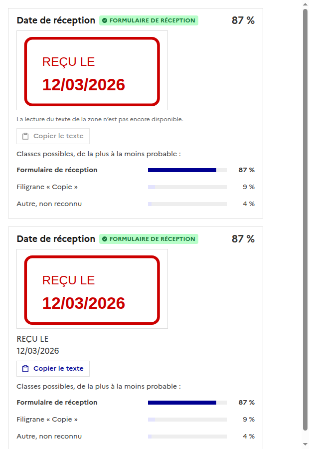
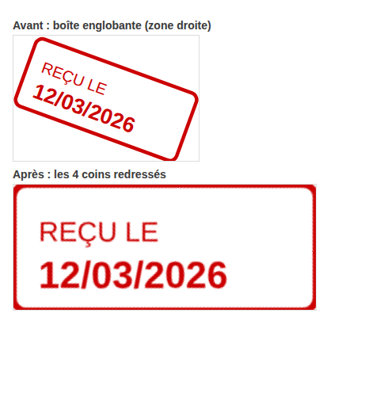

# Résultat d'une analyse : la carte d'un élément

Chaque élément trouvé dans un document est montré à deux endroits.

- **Sur le document** : la zone est entourée et porte le nom de l'**entité** (« Élément n » quand elle n'est pas connue),
  avec ce qui en a été décidé (`✓` validé, `✗` invalidé, `✎` annoté) ou, tant qu'il n'est pas relu, la confiance.
  Le modèle n'y figure pas.
- **Dans la carte** (`DetectionCard`) : le nom de l'entité en titre, le **modèle** reconnu en badge, la confiance, une
  vignette de la zone recadrée (`ZoneCrop`) et les classes possibles de la plus à la moins probable.

L'entité vient de `entityId` : le backend ne la garde que si elle existe dans le modèle, sinon elle est vide.
La confiance affichée est celle de la classification, pas celle de la lecture de la valeur.

Le bouton **Copier le texte** attend la lecture du texte de la zone (OCR), pas encore faite : il est désactivé tant que
`text` est vide (carte du haut), puis copie le texte affiché (carte du bas).

## Une entité à plusieurs zones

Une même information peut apparaître à plusieurs endroits d'un document type : un numéro en en-tête et en pied de page, une
date au recto et au verso. Une entité porte alors une **liste de zones** (10 au plus), chacune avec sa page et son polygone.

- **API** : `zones: Zone[]` sur chaque entité d'un modèle. `zone` (la première) est toujours renvoyée, pour les clients qui
  n'en connaissent qu'une ; en entrée, `zone` seule est lue comme une liste d'une zone.
- **Analyse** : chaque zone est reportée sur le document. L'entité renvoie **une détection par zone**, avec le même
  `entityId` et l'indice de la zone (`zoneIndex`, à partir de 0). La carte d'une détection dit « zone 2 sur 3 ».
- **Qualité** : le rappel et la précision d'une entité se comptent sur l'entité, une fois par essai : si une de ses zones est
  fausse ou a été ajoutée à la main, c'est l'entité qui l'est (les compteurs d'éléments du modèle comptent, eux, chaque zone).
- **Versions** : changer les zones est un changement de « Z » (les entités). Les versions gardées avant (une seule `zone`)
  restent lisibles et restaurables.

## Une zone sur un document penché

Le worker reporte les coins de chaque zone du modèle sur le document (homographie), **dans le même ordre** : haut gauche,
haut droite, bas droite, bas gauche. Quand une zone de quatre coins n'est pas droite sur la page (document scanné de
travers ou à l'envers), la vignette la **redresse** avec une transformation de perspective CSS (`matrix3d`, voir
`composables/perspective.ts`), sans rien changer au backend. Une zone droite est simplement découpée par sa boîte, et
une zone qui n'a pas quatre coins (polygone libre) aussi : elle n'a pas de « haut » défini.

La capture est faite avec des données fictives.
