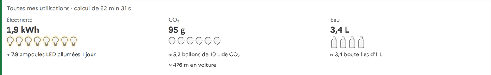
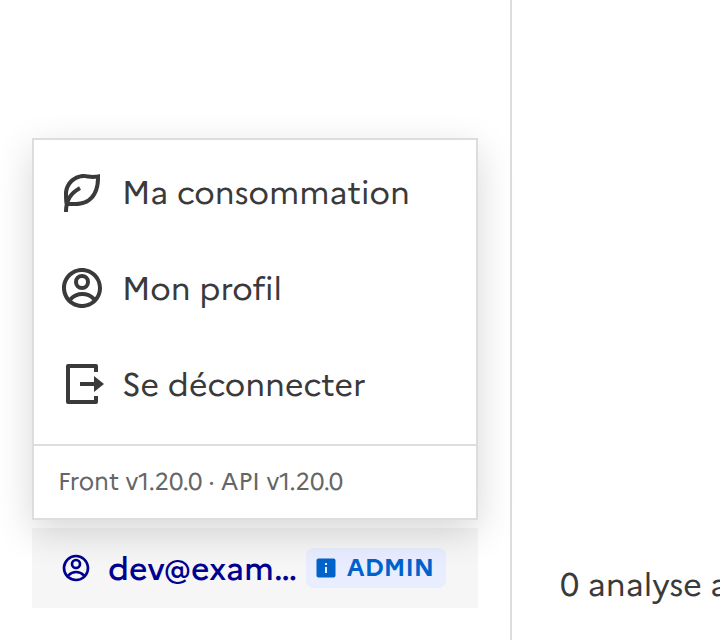

# Consommation d'une utilisation

Chaque utilisation d'une analyse dit ce qu'elle a consommé : l'**électricité**, le **CO₂** que cette électricité a fait
émettre, et l'**eau** qu'elle a coûté, avec à chaque fois de quoi se représenter la quantité.

## Où c'est affiché

- **Résultat d'une utilisation** : sous le résumé de ce qui a été trouvé.
- **Page d'une analyse**, onglet « Utilisations » : le total de toutes ses utilisations mesurées, et une ligne par
  utilisation.
- **Vue d'ensemble** (administrateur) : le total de tout le service.
- **Menu du compte, « Ma consommation »** : ce que *mes* utilisations ont consommé, au total et analyse par analyse
  (voir plus bas).

Une utilisation qui n'a pas été mesurée (celles d'avant cette fonction, ou une mesure qui a échoué) n'affiche rien et ne
compte pour rien dans les totaux.

## D'où viennent les chiffres

| Quoi | Comment |
| --- | --- |
| Électricité (Wh), CO₂ (g), durée | **Mesurés** par le worker avec [CodeCarbon](https://codecarbon.io) autour du calcul d'une utilisation (puissance du processus du worker, intensité carbone du pays). Enregistrés dans la table `runs` (`energy_kwh`, `co2_kg`, `duration_s`). |
| Eau (mL) | **Estimée** par le backend à partir de l'électricité : `WATER_LITERS_PER_KWH` (1,8 L/kWh par défaut, moyenne des centres de données). CodeCarbon ne connaît pas l'eau d'un hôte qui n'est pas celui d'un cloud. |
| Équivalents | **Ordres de grandeur**, tous dans `frontend/src/composables/consumption.ts` : un muffin ≈ 70 Wh de four, une ampoule LED de 10 W, une bouteille de 50 cl, une cuillère à café de 5 mL, une voiture à 200 g de CO₂ par km. |

Les équivalents changent d'échelle avec la quantité : l'électricité se lit en durée d'ampoule LED allumée puis en
muffins cuits, l'eau en cuillères à café puis en bouteilles, le CO₂ en mètres puis en kilomètres de voiture.

## Réglages

Worker :

| Variable | Défaut | Effet |
| --- | --- | --- |
| `MEASURE_CONSUMPTION` | `1` | `0` ne mesure plus rien. |
| `COUNTRY_ISO_CODE` | `FRA` | Le pays dont l'intensité carbone de l'électricité est prise. |
| `CONSUMPTION_TRACKING_MODE` | `process` | `machine` mesure l'hôte entier : trop quand il est partagé. |

Backend : `WATER_LITERS_PER_KWH` (1,8).

## À savoir

- Une mesure ne fait jamais échouer une utilisation : si CodeCarbon ne peut pas lire le matériel, l'utilisation est
  calculée et simplement pas mesurée.
- Seules les utilisations qui se terminent bien sont mesurées : le calcul d'une utilisation en échec ou annulée n'est
  pas compté.
- Dans un conteneur, CodeCarbon ne lit souvent pas la puissance réelle (RAPL) : il l'estime alors à partir du
  processeur. C'est un ordre de grandeur, pas un wattmètre.
- La capture est faite avec des données fictives.

## Des choses qu'on peut compter

Chaque bloc de consommation dit, sous les chiffres, ce que c'est **en choses qu'on compte**, dessinées et **animées** : elles
se remplissent à l'affichage, l'une après l'autre. Trois bouteilles pleines et une à 40 %, c'est « 3,4 bouteilles d'1 L ».

| | Unités, de la plus petite à la plus grande |
| --- | --- |
| Électricité (ampoule LED de 10 W) | allumée 1 minute, 1 heure, 1 jour, 1 mois, 1 an |
| CO₂ (ballon de gaz, 1 L de CO₂ pèse environ 1,84 g) | ballon de 1 L, de 10 L, de 100 L, de 1 000 L |
| Eau | cuillère à café (5 mL), verre (20 cL), bouteille d'1 L, seau de 10 L, baignoire (150 L) |

- **Jamais plus de 10.** L'unité est la plus petite dont il y a **moins de dix** : pas « 100 bouteilles », mais « 10 seaux ». Au-delà
  de la plus grande unité, c'est écrit « **plus de 10** baignoires » et dix sont dessinées, pleines.
- **En dessous de la plus petite unité**, il n'y en a qu'une partie, dessinée (un peu s'en voit toujours quand il y a quelque
  chose).
- Pour le CO₂, l'équivalent en voiture (« 476 m en voiture ») reste affiché.
- **Après le remplissage**, ça bouge un peu : une vague sur l'eau, des bulles dans les ballons, un halo qui pulse autour des
  ampoules.
- **Moins de mouvement** : si votre système le demande (`prefers-reduced-motion`), tout apparaît déjà rempli, rien ne bouge.
- Les dessins sont cachés aux lecteurs d'écran : le texte (« 3,4 bouteilles d'1 L ») dit la même chose.
- Les unités et leurs valeurs sont des constantes de `frontend/src/composables/consumption.ts` (`LADDERS`), à corriger à un
  seul endroit. Ce sont des ordres de grandeur, pas des mesures. Les chiffres de la capture ci-dessus sont ceux d'un usage
  important, fabriqués pour l'exemple.

## Ma consommation (mon profil)

Cliquez sur **votre nom**, en bas du menu : un menu s'ouvre avec « Ma consommation », « Mon profil » et « Se déconnecter »,
et en bas les versions du frontend et de l'API.

- **En haut** : le total de toutes mes utilisations mesurées (électricité, CO₂, eau, avec les équivalents).
- **Le détail par analyse**, de la plus consommatrice à la moins consommatrice : le nombre d'utilisations (et combien sont
  mesurées, quand ce n'est pas toutes), l'électricité, le CO₂, l'eau et la durée de calcul. Le nom de l'analyse ouvre sa page.
- Seules **mes** utilisations sont comptées, pas celles des autres personnes d'une analyse partagée. Une utilisation est un
  test sur un document : la première utilisation d'une analyse, faite avec elle, n'en est pas une.
- Une utilisation qui n'a pas été mesurée compte comme une utilisation mais ne consomme rien dans les totaux.

Les chiffres viennent de `GET /api/metrics/me/consumption`, calculés par la base à partir des mêmes colonnes de `runs`.
