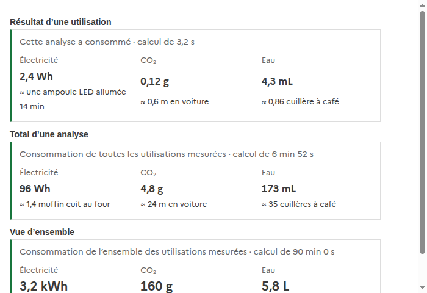
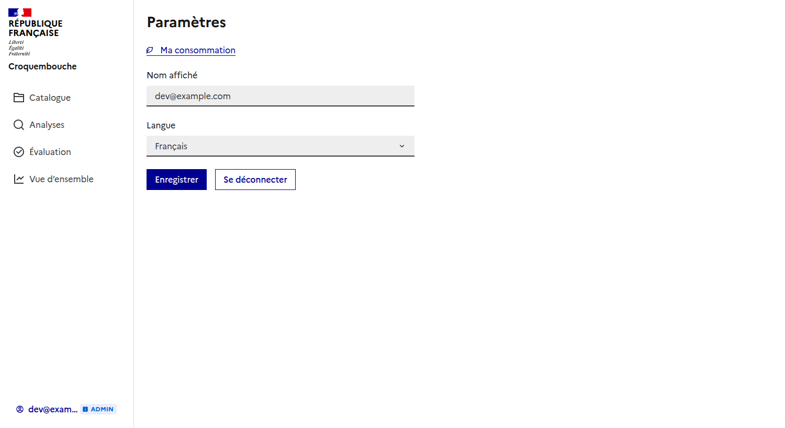
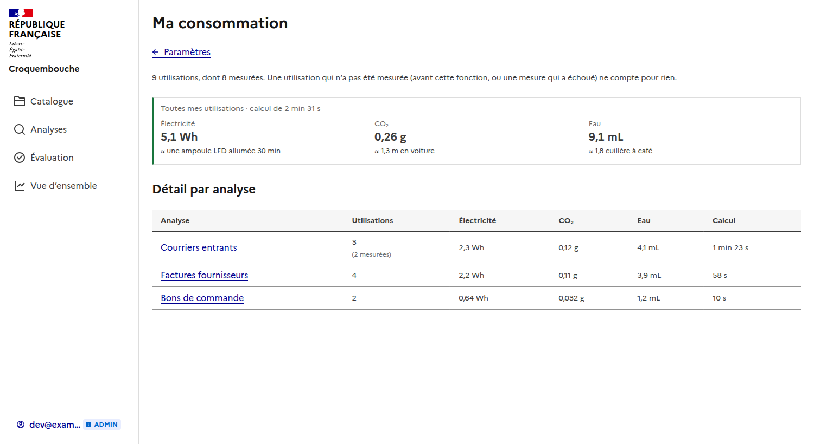

# Consommation d'une utilisation

Chaque utilisation d'une analyse dit ce qu'elle a consommé : l'**électricité**, le **CO₂** que cette électricité a fait
émettre, et l'**eau** qu'elle a coûté, avec à chaque fois de quoi se représenter la quantité.

## Où c'est affiché

- **Résultat d'une utilisation** : sous le résumé de ce qui a été trouvé.
- **Page d'une analyse**, onglet « Utilisations » : le total de toutes ses utilisations mesurées, et une ligne par
  utilisation.
- **Vue d'ensemble** (administrateur) : le total de tout le service.
- **Mon profil, « Ma consommation »** : ce que *mes* utilisations ont consommé, au total et analyse par analyse
  (voir plus bas).

Une utilisation qui n'a pas été mesurée (celles d'avant cette fonction, ou une mesure qui a échoué) n'affiche rien et ne
compte pour rien dans les totaux.

## D'où viennent les chiffres

| Quoi | Comment |
| --- | --- |
| Électricité (Wh), CO₂ (g), durée | **Mesurés** par le worker avec [CodeCarbon](https://codecarbon.io) autour du calcul d'une utilisation (puissance du processus du worker, intensité carbone du pays). Enregistrés dans la table `runs` (`energy_kwh`, `co2_kg`, `duration_s`). |
| Eau (mL) | **Estimée** par le backend à partir de l'électricité : `WATER_LITERS_PER_KWH` (1,8 L/kWh par défaut, moyenne des centres de données). CodeCarbon ne connaît pas l'eau d'un hôte qui n'est pas celui d'un cloud. |
| Équivalents | **Ordres de grandeur**, tous dans `frontend/src/composables/consumption.ts` : un muffin ≈ 70 Wh de four, une ampoule LED de 10 W, une bouteille de 50 cl, une cuillère à café de 5 mL, une voiture à 200 g de CO₂ par km. |

Les équivalents changent d'échelle avec la quantité : l'électricité se lit en durée d'ampoule LED allumée puis en
muffins cuits, l'eau en cuillères à café puis en bouteilles, le CO₂ en mètres puis en kilomètres de voiture.

## Réglages

Worker :

| Variable | Défaut | Effet |
| --- | --- | --- |
| `MEASURE_CONSUMPTION` | `1` | `0` ne mesure plus rien. |
| `COUNTRY_ISO_CODE` | `FRA` | Le pays dont l'intensité carbone de l'électricité est prise. |
| `CONSUMPTION_TRACKING_MODE` | `process` | `machine` mesure l'hôte entier : trop quand il est partagé. |

Backend : `WATER_LITERS_PER_KWH` (1,8).

## À savoir

- Une mesure ne fait jamais échouer une utilisation : si CodeCarbon ne peut pas lire le matériel, l'utilisation est
  calculée et simplement pas mesurée.
- Seules les utilisations qui se terminent bien sont mesurées : le calcul d'une utilisation en échec ou annulée n'est
  pas compté.
- Dans un conteneur, CodeCarbon ne lit souvent pas la puissance réelle (RAPL) : il l'estime alors à partir du
  processeur. C'est un ordre de grandeur, pas un wattmètre.
- La capture est faite avec des données fictives.

## Ma consommation (mon profil)

Depuis les **Paramètres** (le bouton avec votre nom, en bas du menu), le lien « Ma consommation » ouvre la page de ce que
**vos** utilisations ont consommé.

- **En haut** : le total de toutes mes utilisations mesurées (électricité, CO₂, eau, avec les équivalents).
- **Le détail par analyse**, de la plus consommatrice à la moins consommatrice : le nombre d'utilisations (et combien sont
  mesurées, quand ce n'est pas toutes), l'électricité, le CO₂, l'eau et la durée de calcul. Le nom de l'analyse ouvre sa page.
- Seules **mes** utilisations sont comptées, pas celles des autres personnes d'une analyse partagée. Une utilisation est un
  test sur un document : la première utilisation d'une analyse, faite avec elle, n'en est pas une.
- Une utilisation qui n'a pas été mesurée compte comme une utilisation mais ne consomme rien dans les totaux.

Les chiffres viennent de `GET /api/metrics/me/consumption`, calculés par la base à partir des mêmes colonnes de `runs`.
