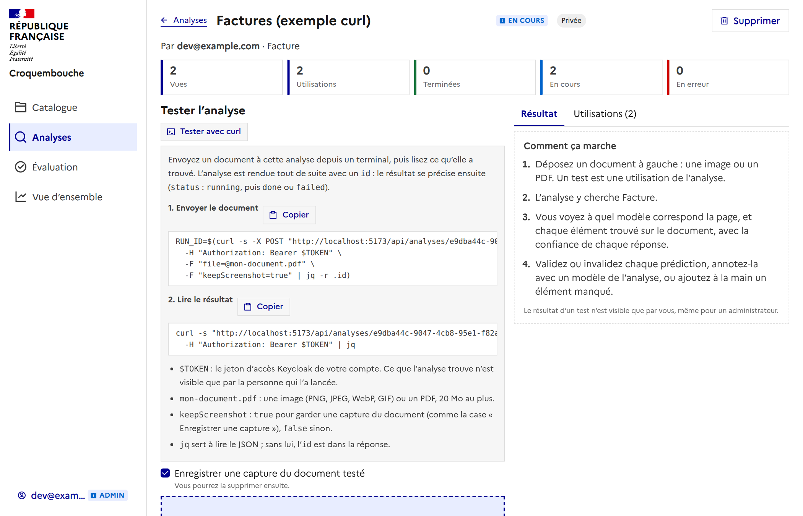

# Tester une analyse avec curl

Sur la page d'une analyse, le bouton **« Tester avec curl »** (au-dessus de la zone de dépôt) montre les commandes pour
envoyer un document à cette analyse depuis un terminal et lire ce qu'elle a trouvé. Elles sont prêtes à **copier**, avec
l'adresse de l'application et l'identifiant de l'analyse.



## Les deux appels

```bash
# 1. Envoyer le document : l'analyse répond tout de suite avec l'id de l'utilisation
RUN_ID=$(curl -s -X POST "https://…/api/analyses/<id>/runs" \
  -H "Authorization: Bearer $TOKEN" \
  -F "file=@mon-document.pdf" \
  -F "keepScreenshot=false" | jq -r .id)

# 2. Lire le résultat
curl -s "https://…/api/analyses/<id>/runs/$RUN_ID" \
  -H "Authorization: Bearer $TOKEN" | jq
```

- **`$TOKEN`** : le jeton d'accès Keycloak de votre compte (`Authorization: Bearer`). Ce que l'analyse trouve n'est visible que
  par la personne qui l'a lancée, un administrateur compris : le jeton est donc le vôtre.
- **`file`** : une image (PNG, JPEG, WebP, GIF) ou un PDF, 20 Mo au plus.
- **`keepScreenshot`** : `true` pour garder une capture du document, `false` sinon. Dans l'exemple, la valeur suit la case
  « Enregistrer une capture du document testé » de la page.
- **`jq`** lit le JSON ; sans lui, l'`id` est dans la réponse.

## Ce que l'on lit

L'appel 1 répond `201` avec l'utilisation, `status: "running"`. L'appel 2, répété, suit son évolution :

| `status` | Sens |
| --- | --- |
| `running` | L'analyse travaille (le matching, puis l'OCR et la recherche des entités sans zone, qui arrivent après). |
| `done` | Terminée : `detections` (les éléments trouvés), `pages` (le modèle de chaque page), `consumption`. |
| `failed` | Elle a échoué. |
| `cancelled` | Elle a été annulée. |

Le texte lu par l'OCR (`ocr`, et `text` de chaque élément) est dans cette même réponse une fois `ocrStatus` à `done`
(et `findStatus` à `done` pour les entités retrouvées par leur définition).

## Où c'est dans le code

`frontend/src/components/CurlExample.vue` (le bouton) et `frontend/src/composables/curlExample.ts` (le texte des commandes,
testé). L'API est `POST /api/analyses/{id}/runs` et `GET /api/analyses/{id}/runs/{run_id}`.
