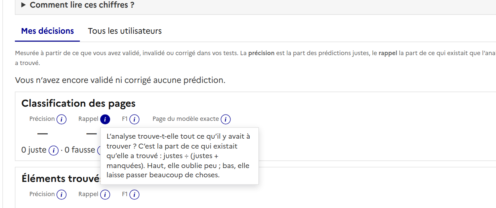
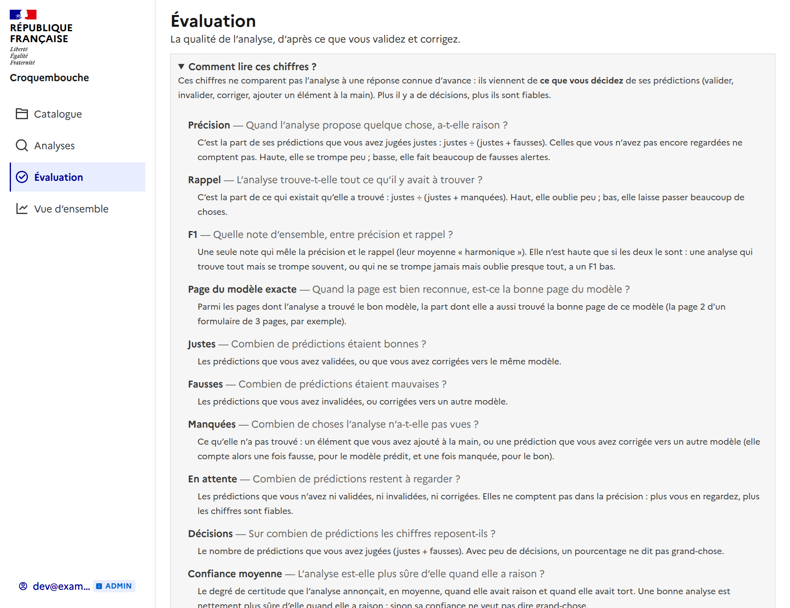

# Évaluation : comprendre les chiffres

La page **Évaluation** (et l'onglet « Qualité » d'un modèle) dit si l'analyse a raison. Chaque chiffre s'explique en quelques
mots, de deux façons.

## Une info-bulle à côté de chaque chiffre

Le petit **ⓘ** à côté de la précision, du rappel, du F1, de la page exacte, des justes, des fausses, des manquées, de ce
qui est en attente et de la confiance moyenne ouvre son explication : une question (« L'analyse trouve-t-elle tout ce
qu'il y avait à trouver ? ») puis la réponse, en une ou deux phrases.

## « Comment lire ces chiffres ? »

En haut de la page, ce bloc déplie **tous** les chiffres, dans l'ordre, avec **un exemple** à suivre.

| Chiffre | En une phrase |
| --- | --- |
| **Précision** | Quand l'analyse propose quelque chose, a-t-elle raison ? justes ÷ (justes + fausses). |
| **Rappel** | Trouve-t-elle tout ce qu'il y avait à trouver ? justes ÷ (justes + manquées). |
| **F1** | Une note d'ensemble, haute seulement si la précision et le rappel le sont. |
| **Page du modèle exacte** | Quand la page est bien reconnue, est-ce la bonne page du modèle ? |
| **Justes / Fausses / Manquées / En attente** | Prédictions bonnes, mauvaises, ce qu'elle n'a pas vu, ce qui reste à regarder. |
| **Décisions** | Sur combien de prédictions les chiffres reposent. |
| **Confiance moyenne** | Est-elle plus sûre d'elle quand elle a raison ? |

L'exemple : l'analyse propose 10 éléments, vous en validez 8 et en invalidez 2, et vous en ajoutez 4 à la main qu'elle n'avait
pas vus. Précision 8 ÷ 10 = 80 %, rappel 8 ÷ 12 = 67 %, F1 73 %.

## D'où viennent les chiffres

Il n'y a pas de réponse connue d'avance : ils viennent de **ce que vous décidez** des prédictions (valider, invalider, corriger,
ajouter un élément à la main), donc ils se précisent à chaque décision. Le calcul est dans
`backend/app/services/metrics.py` ; les textes sont dans `frontend/src/composables/qualityHelp.ts`, à corriger à un seul
endroit.
