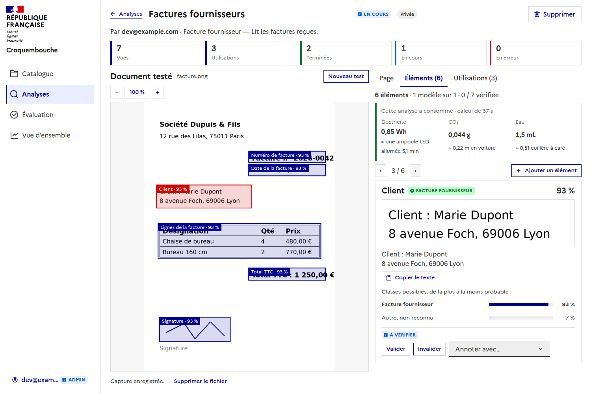
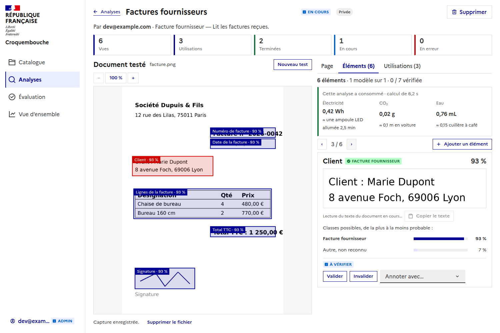
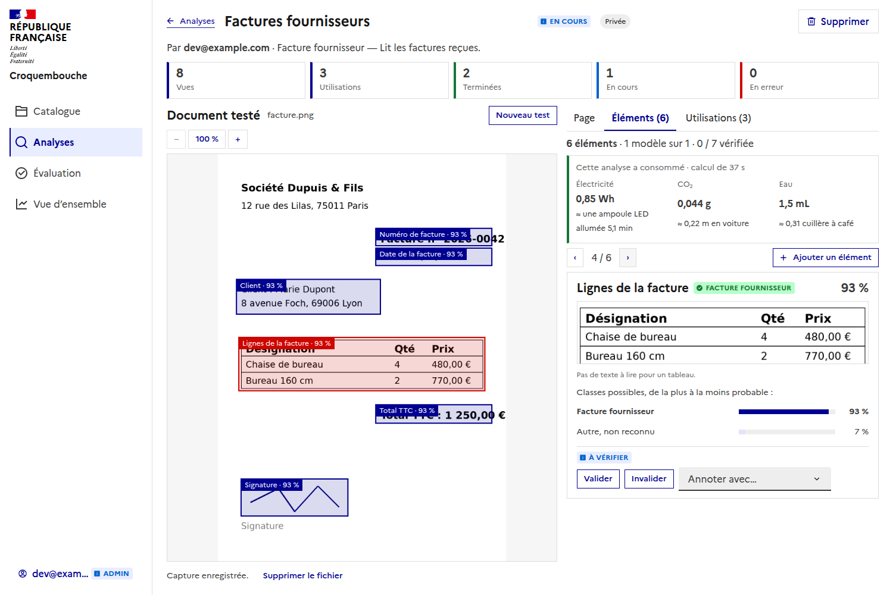

# Lecture du texte (OCR)

En plus de chercher les éléments des modèles, chaque utilisation **lit le texte du document** avec
[PaddleOCR](https://github.com/PaddlePaddle/PaddleOCR), sur CPU. Le texte de la zone de chaque élément s'affiche sur sa
carte, avec un bouton pour le copier.

## Deux temps

La lecture se fait **en parallèle** de l'analyse (`worker/ocr` d'un côté, `worker/template_matching` de l'autre) et
**l'analyse n'attend pas** : son résultat s'affiche dès qu'il est prêt, le texte arrive ensuite.

Une utilisation a donc deux états indépendants : `status` (l'analyse) et `ocrStatus` (`none`, `running`, `done`,
`failed`). La page continue de s'enquérir de l'utilisation tant que le texte n'est pas lu. Si la lecture échoue, on perd
le texte, pas l'analyse.

## Quels éléments ont un texte

| Type de l'entité | Texte |
| --- | --- |
| texte, date, entier, décimal, montant, pourcentage, oui/non | Les lignes lues dont le centre est dans la zone, de haut en bas. |
| image (signature, tampon, logo) | Aucun : il n'y a rien à lire. |
| tableau | Aucun : il sera lu autrement. |

Un élément dont l'entité n'est pas connue (dessiné à la main, ou entité supprimée) est traité comme un texte.

## Retrouver une entité sans zone (GLiNER)

Une entité n'a pas toujours de zone à reporter sur le document : son modèle n'a pas d'image ni de PDF, ou la zone n'a
pas été dessinée. Un **worker à part**, `worker/gliner`, cherche alors sa valeur **dans le texte lu** avec
[GLiNER](https://github.com/urchade/GLiNER) (extraction d'entités « zero-shot »), et rend un élément avec sa zone.

**GLiNER attend l'OCR.** Il lui faut le texte : le backend ne lui envoie sa tâche qu'une fois que l'OCR a répondu. Une
utilisation a un troisième état, `findStatus` : `none` (rien à retrouver), `waiting` (le texte n'est pas encore lu),
`running` (GLiNER cherche), `done`, `failed`. Si le texte ne peut pas être lu, ou n'a aucune ligne, il n'y a rien à
chercher dedans.

- **Quelles entités** : celles d'un modèle **sans document** (aucune n'a de zone), et celles **sans zone** d'un modèle qui
  en a un. Une entité de type image ou tableau n'a pas de texte à retrouver : elle est ignorée.
- **Ce qu'on demande à GLiNER** : la **définition** de l'entité (son nom si elle n'en a pas). Plus la définition est
  précise (« Le numéro de la facture »), mieux c'est.
- **La zone** est celle de ce qui a été trouvé : la partie de la ligne OCR où se trouve le texte (au prorata des
  caractères), ou le rectangle autour de plusieurs lignes. Elle est approximative, la carte le dit.
- **La confiance** est celle de GLiNER, le reste étant « autre ». Pour chaque entité, on garde la réponse la plus sûre sur
  **toutes** les pages : sans zone, on ne sait pas sur quelle page elle est.
- **Le texte trouvé** est gardé chiffré avec l'élément (`detections.text_encrypted`) et rendu tel quel.
- Ces éléments arrivent **après le texte**, donc après l'analyse, et s'ajoutent à ceux qu'elle a trouvés (qui ne les
  remplacent pas). Si GLiNER échoue ou n'est pas déployé, on perd ces éléments, pas le texte ni l'analyse.
- Sa consommation (CodeCarbon) s'ajoute à celle de l'utilisation.
- Le modèle (et son tokenizer) est dans l'image : rien n'est téléchargé au démarrage.

Réglages du worker : `GLINER_MODEL` (`urchade/gliner_multi-v2.1`, multilingue, à la construction de l'image),
`GLINER_THRESHOLD` (`0.4`), `GLINER_CHUNK_WORDS` (`250` : GLiNER lit environ 380 mots à la fois, une page est lue par
morceaux). Backend : `GLINER_ENABLED` (`true`) : `false` ne cherche plus rien par la définition.

## Les modèles

PaddleOCR **PP-OCRv6 « tiny »** (détection `PP-OCRv6_tiny_det`, reconnaissance `PP-OCRv6_tiny_rec`, quelques millions de paramètres), exécutés
par **ONNX Runtime sur le CPU** : le worker n'a plus besoin du framework `paddlepaddle` (image plus légère, démarrage plus rapide). La
reconnaissance « tiny » lit **49 langues** (le japonais excepté) : il n'y a plus de langue à choisir. La page et chaque ligne sont remises d'aplomb
par les modèles d'orientation de Paddle, comme avant. Pour un texte plus difficile, des modèles plus gros (`PP-OCRv6_small_*`) se choisissent par
`OCR_DET_MODEL` et `OCR_REC_MODEL`.

Avant, le worker utilisait les modèles par défaut de PaddleOCR 3.7 : **PP-OCRv6 « medium »** (`PP-OCRv6_medium_det` et `PP-OCRv6_medium_rec`) sur le framework
Paddle. Comparaison sur la même machine, la même image (quatre lignes en français, page droite), dans les deux images construites, sans réseau :

| | PP-OCRv6 medium, Paddle (avant) | PP-OCRv6 tiny, ONNX Runtime (maintenant) |
| --- | --- | --- |
| Lecture d'une page (après la première) | environ 5 à 6 s | environ 0,35 s |
| Première lecture (chargement) | environ 11 s | environ 3 s |
| Taille de l'image | 2,55 Go | 1,47 Go |
| Confiance des lignes | 0,990 à 0,9997 | 0,96 à 0,99 |
| Texte | « n° 2026 », « total : 1 250 » | « n°2026 », « total:1 250 » (espaces) |

Le « tiny » est donc **une quinzaine de fois plus rapide** et plus léger, pour un texte lu un peu moins sûrement (les espaces autour de la ponctuation).
C'est un ordre de grandeur sur une image simple, pas un banc d'essai : à refaire sur des documents réels (PDF scannés, tableaux, tampons) avant
d'en faire une garantie, et à garder en tête si les entités sont cherchées dans ce texte (GLiNER) ou lues par zone.

## Ce que fait le worker

- Il remet la page d'aplomb (0, 90, 180 ou 270°) et chaque ligne à l'endroit avant de lire : un scan couché ou à l'envers
  est lu normalement. `angle` dit de combien la page était tournée.
- Il rend chaque ligne avec son texte, sa confiance et ses quatre coins **sur la page telle qu'elle a été envoyée**, de 0 à
  1 comme les zones des modèles : les deux se comparent directement.
- Il mesure sa consommation avec CodeCarbon, qui **s'ajoute** à celle de l'analyse : la consommation d'une utilisation est
  celle des deux.
- Les modèles sont dans l'image : rien n'est téléchargé au démarrage. D'autres modèles sont une autre image
  (`--build-arg OCR_DET_MODEL=... --build-arg OCR_REC_MODEL=...`).

## Où est gardé le texte

Dans la table `runs` (`ocr_status`, `ocr_encrypted`), **chiffré** comme le nom du fichier : c'est le contenu du document.
Il n'est renvoyé que par `GET /api/analyses/{id}/runs/{run_id}`, à la personne qui a lancé l'utilisation, jamais dans la
liste des utilisations d'une analyse. Le document lui-même n'est supprimé qu'une fois l'analyse **et** la lecture
terminées (sauf si la capture est gardée).

## Réglages

Worker (`worker/ocr`) :

| Variable | Défaut | Effet |
| --- | --- | --- |
| `OCR_DET_MODEL` | `PP-OCRv6_tiny_det` | Le modèle de détection des lignes (à la construction de l'image). |
| `OCR_REC_MODEL` | `PP-OCRv6_tiny_rec` | Le modèle de reconnaissance du texte (à la construction de l'image). |
| `OCR_ENGINE` | `onnxruntime` | Ce qui les exécute : `onnxruntime` (les modèles ONNX), ou `paddle` (demande le paquet `paddlepaddle`). |
| `OCR_MIN_SCORE` | `0.5` | Sous cette confiance, une ligne est écartée. |
| `OCR_CPU_THREADS` | `0` | Les threads de calcul (0 : le choix d'ONNX Runtime, qui convient à un petit modèle). |
| `MEASURE_CONSUMPTION`, `COUNTRY_ISO_CODE`, `CONSUMPTION_TRACKING_MODE` | | Comme pour l'analyse, voir [consumption.md](consumption.md). |

Backend : `OCR_ENABLED` (`true`) : `false` ne lit plus aucun texte.
