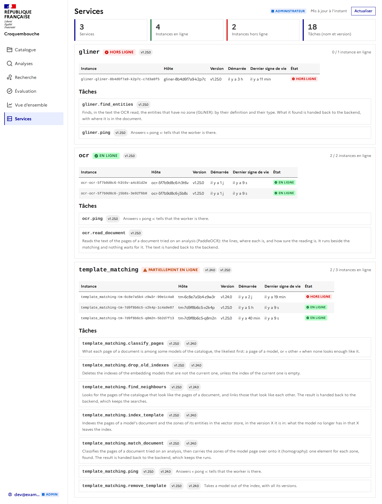
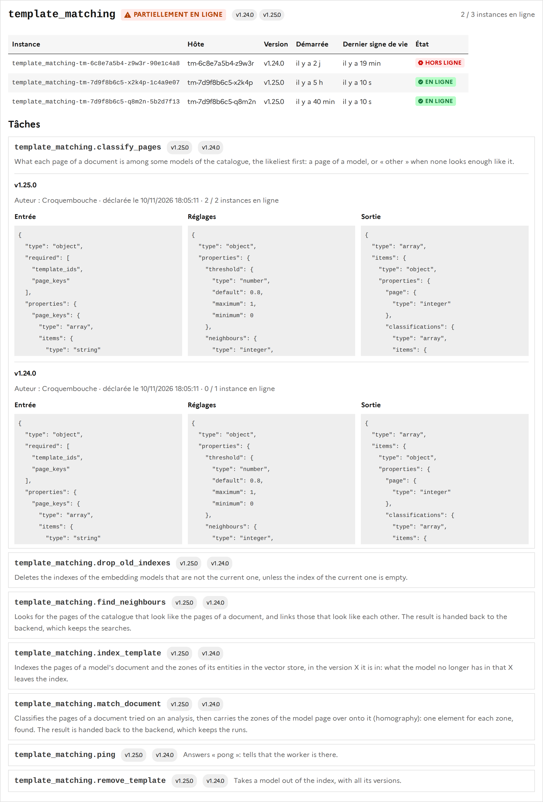
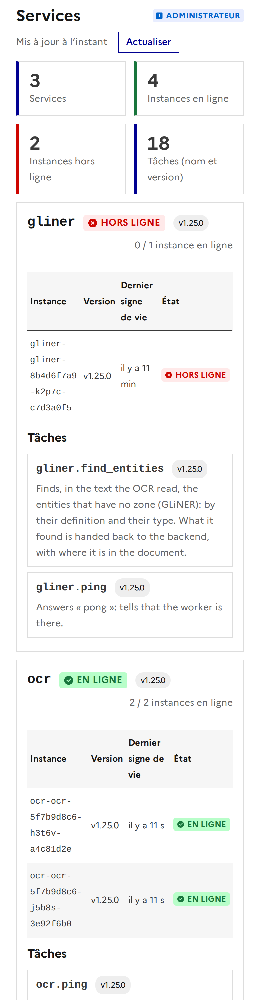

# Les tâches des workers

Chaque worker (`template_matching`, `ocr`, `gliner`) **déclare au backend** les tâches qu'il sait faire, avec leur version, et dit
régulièrement qu'il est vivant. Le backend les liste : `GET /api/tasks`.

## Ce qu'une tâche déclare

| Champ | Contenu |
| ----- | ------- |
| `name` | Le nom de la tâche Celery : `template_matching.classify_pages`, `ocr.read_document`… |
| `version` | La version du worker qui la porte (celle de son paquet, que change une release). |
| `description` | Ce qu'elle fait. |
| `author` | Qui l'a faite (`WORKER_AUTHOR`, « Croquembouche » par défaut). |
| `inputSchema` | Ce qu'elle prend, en JSON Schema : un objet dont les propriétés sont les arguments de la tâche, par nom. |
| `parameters` | Ce qu'on peut régler, en JSON Schema : les réglages du worker qui changent ce qu'elle fait (seuils, modèle, langue), avec leur valeur actuelle en `default`. |
| `outputSchema` | Ce qu'elle donne, en JSON Schema : sa valeur de retour, ou ce qu'elle rend au backend (les tâches de calcul rendent leur résultat par `/internal/...`). |

Les schémas sont dans `worker/<nom>/app/catalog.py`.

**Ce que prennent les tâches de lecture** (les deux se suivent) :

- `ocr.read_document` ne prend **pas le document** : il prend `{run_id, page_keys}`, les **clés des images des pages dans le stockage d'objets** (S3, bucket
  `AWS_BUCKET`, `croquembouche-documents` par défaut), une par page. Le backend les fabrique à l'envoi du document : `<document>/pages/<n>.png` pour un PDF
  (une capture de chaque page), `<document>/original.<extension>` pour une image. Le worker lit chaque objet dans le stockage : il doit pouvoir le joindre.
  Il rend le texte lu : `pages: [{page, angle, lines: [{text, score, points}]}]`.
- **`template_matching`** a la même forme de document que l'OCR : jamais les octets, toujours des **clés d'images dans le stockage d'objets**.
  - `classify_pages(template_ids, page_keys)` : les `page_keys` du document (clés des images de ses pages, comme ci-dessus) et les **identifiants** des modèles à comparer ;
    les modèles ne sont pas passés, ils sont cherchés dans l'**index** (Qdrant) que `index_template` a rempli.
  - `match_document({run_id, templates, page_keys})` : les `page_keys` du document analysé, et `templates`, les modèles de l'analyse **tels que le backend les décrit** :
    pour chacun (et chaque X qu'il a eu, ou la version épinglée) `{template_id, major, version, pages: [{page, key}], entities: [{id, page, points, zone?}]}`.
    Les `key` des pages du modèle sont des clés S3 du même genre (les images de son document d'exemple) : elles sont lues pour **reporter les zones** des entités sur le
    document (homographie). Les `points` sont un polygone en fractions (0 à 1) de la page ; `zone` est l'indice de la zone d'une entité qui en a plusieurs.
  - `index_template({template})` : le même objet « modèle » (les clés des images de ses pages, lues ici, et les zones de ses entités).
  - `find_neighbours({search_id, page_keys, k, template_ids?})` : les `page_keys` du document de la recherche ; `template_ids` absent veut dire tout le catalogue.
- `gliner.find_entities` prend **la sortie de l'OCR telle quelle** (`pages`, le même schéma) **et les définitions** des entités à trouver :
  `{run_id, pages, entities: [{id, template_id, name, definition, type, examples}]}`. Ce sont les entités des modèles qui n'ont pas de zone à reporter ;
  GLiNER les cherche dans le texte d'après ce qu'elles sont. Un test de chaque worker vérifie que ce catalogue et les tâches Celery sont les mêmes :
on ne peut pas ajouter une tâche sans la décrire.

## Les tables

- **`worker_heartbeats`** : une ligne par instance de worker (`instance_id`, `service`, `hostname`, `started_at`, `last_seen_at`). L'`instance_id`
  est refait à chaque démarrage : deux processus, ou un redémarrage, sont deux instances.
- **`worker_tasks`** : une ligne par tâche et par instance (`name`, `version`, `description`, `input_schema`, `parameters`, `output_schema`, `author`,
  `instance_id`, `created_at`). Unique sur (`name`, `version`, `instance_id`). Supprimer une instance supprime ses tâches.

## Le protocole (réservé au worker, clé `X-Internal-Key`)

| Appel | Quand |
| ----- | ----- |
| `PUT /internal/workers/{instance_id}` | Au démarrage : `{service, hostname, tasks: […]}`. Remplace ce que l'instance avait déclaré. |
| `POST /internal/workers/{instance_id}/heartbeat` | Toutes les `WORKER_HEARTBEAT_SECONDS` (30 s). Répond `404` si le backend ne connaît pas l'instance (il a été redémarré sans sa base) : l'instance **se déclare de nouveau**. |
| `DELETE /internal/workers/{instance_id}` | À l'arrêt propre : ses tâches ne sont plus offertes. |

Le worker ne s'arrête jamais à cause de cela : un backend injoignable est réessayé au battement suivant. `REGISTER_TASKS=0` désactive tout.

## Lire les tâches

`GET /api/tasks` (toute personne connectée, un compte de service aussi) : une entrée par **nom et version**, avec les instances qui l'ont.

- Une instance est **en ligne** si elle a donné signe de vie depuis `WORKER_HEARTBEAT_TTL_SECONDS` (90 s, réglage du backend). `online` compte ces
  instances ; `?online=true` ne garde que les tâches qu'une instance vivante a.
- Un instance silencieuse reste listée, hors ligne, puis **est oubliée** (avec ses tâches) après `WORKER_PURGE_DAYS` jours (7), au prochain enregistrement.
- Quand les instances d'une même version ne sont pas d'accord, la description et les schémas sont ceux de la plus récemment déclarée.
- `GET /api/tasks/{name}` : toutes les versions d'une tâche (`404` si aucun worker ne la déclare).

Les SDK ont `client.tasks.list()` et `client.tasks.get(nom)` (voir [sdk.md](sdk.md)).

## La page « Services » (administrateurs)

`/services`, dans le menu des administrateurs (sous « Vue d'ensemble »), montre l'état des workers. Elle interroge `GET /api/tasks` toutes les
10 secondes (le bouton « Actualiser » le fait tout de suite) ; tout autre compte est renvoyé vers les analyses.

- **Les chiffres** : nombre de services, d'instances en ligne et hors ligne, de tâches (une par nom et version).
- **Un service** (`gliner`, `ocr`, `template_matching`) : son état, **En ligne** (toutes ses instances sont vivantes), **Partiellement en ligne** (certaines)
  ou **Hors ligne** (aucune) ; ses versions (deux à la fois pendant un déploiement : `v1.24.0` `v1.25.0`) ; et combien d'instances sont en ligne.
- **Ses instances** : l'identifiant, l'hôte, la version, depuis quand elle tourne, le **dernier signe de vie** (« il y a 9 s », la date exacte au survol) et son état.
  Une instance est hors ligne passé 90 secondes sans signe.
- **Ses tâches** : une ligne par tâche, avec ses versions. Ouverte, chaque version dit qui l'a faite, quand elle a été déclarée, combien de ses instances
  sont en ligne, et ses trois schémas.

Sur un téléphone, l'hôte et la date de démarrage s'effacent pour laisser la place à ce qui dit si l'instance est vivante.

